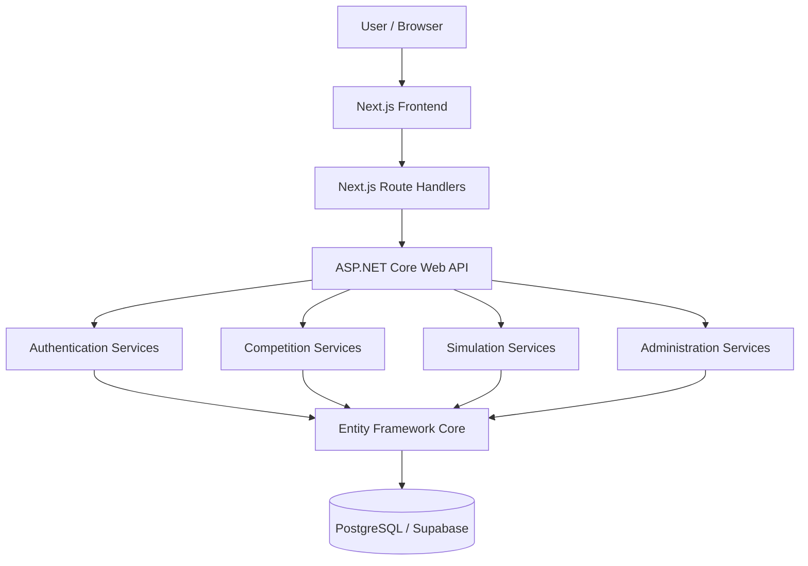
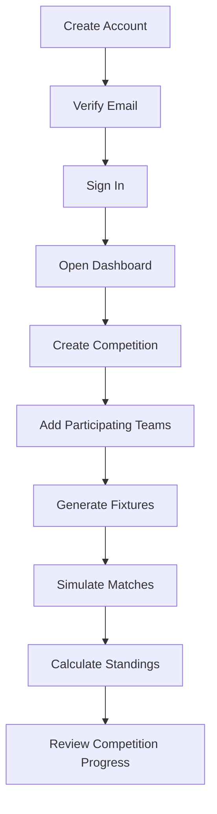
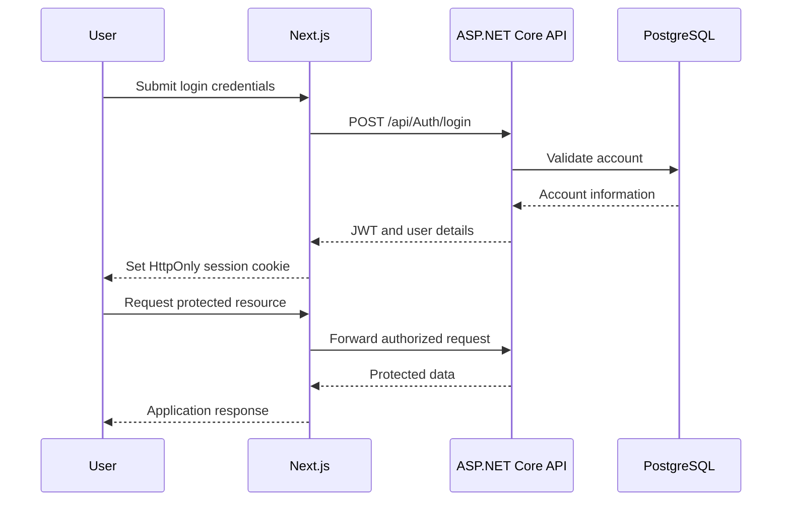
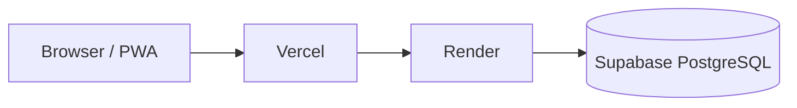

<div align="center">


# ⚽ FootballSim

### Simulate the Game. Own the Competition.

**A modern full-stack football competition management and simulation platform.**

Create competitions, organize clubs, generate fixtures, simulate matches, and track league standings — all from one powerful football workspace.

<br />

[](https://nextjs.org/)
[](https://react.dev/)
[](https://www.typescriptlang.org/)
[](https://dotnet.microsoft.com/)
[](https://www.postgresql.org/)

<br />

[](https://tailwindcss.com/)
[](https://motion.dev/)
[](https://learn.microsoft.com/ef/core/)
[](https://supabase.com/)
[](https://vercel.com/)
[](https://render.com/)

<br />

### 🚀 Live Application

**[Launch FootballSim](https://king-footballsimulator.vercel.app)**

[View Developer Profile](https://github.com/King-web-cell-05) · [Report an Issue](https://github.com/King-web-cell-05)

<br />

**Designed & Developed by Dada Kingsley Oluwasanmi**

</div>

---

## 📖 Table of Contents

- [Overview](#-overview)
- [Why FootballSim?](#-why-footballsim)
- [Key Features](#-key-features)
- [Application Preview](#-application-preview)
- [Technology Stack](#-technology-stack)
- [System Architecture](#-system-architecture)
- [How FootballSim Works](#-how-footballsim-works)
- [Authentication and Security](#-authentication-and-security)
- [Competition and Simulation Engine](#-competition-and-simulation-engine)
- [Admin Management](#-admin-management)
- [Progressive Web App](#-progressive-web-app)
- [Project Structure](#-project-structure)
- [Getting Started](#-getting-started)
- [Environment Configuration](#-environment-configuration)
- [API Overview](#-api-overview)
- [Deployment](#-deployment)
- [Performance and User Experience](#-performance-and-user-experience)
- [Challenges and Engineering Decisions](#-challenges-and-engineering-decisions)
- [Troubleshooting](#-troubleshooting)
- [Future Improvements](#-future-improvements)
- [Contributing](#-contributing)
- [Project Status](#-project-status)
- [Developer](#-developer)

---

## 🌍 Overview

**FootballSim** is a full-stack football competition management and simulation platform designed to provide an organized, interactive, and modern environment for managing football tournaments.

The application allows users to create their own competitions, manage participating clubs, generate fixtures, simulate match results, and monitor league standings.

FootballSim combines a responsive web interface with a dedicated backend football simulation engine.

The frontend is built using **Next.js, React, TypeScript, and Tailwind CSS**, while the backend is powered by **ASP.NET Core Web API, Entity Framework Core, and PostgreSQL**.

The platform also includes account authentication, email verification, administrative management, and Progressive Web App capabilities.

### 🎯 Project Vision

> To build a modern football simulation ecosystem where users can create competitions, control match progression, and experience football tournament management through an intuitive digital platform.

FootballSim is designed around three principles:

**Control.** Give users the tools to manage their competitions.

**Simulation.** Transform fixtures into meaningful results and standings.

**Experience.** Deliver a polished, responsive, and accessible interface across devices.

---

## 💡 Why FootballSim?

Managing football competitions involves multiple connected activities:

- Registering and organizing participating teams.
- Configuring competition structures.
- Generating fixtures and matchdays.
- Recording or simulating match results.
- Calculating points and goal differences.
- Updating standings.
- Monitoring competition progress.

FootballSim brings these activities into one application.

Instead of managing fixtures, results, and league tables separately, users can work within a centralized football competition environment.

### What makes FootballSim different?

| Capability | FootballSim Approach |
|---|---|
| Competition creation | User-managed football competitions |
| Team management | Organized participating clubs |
| Fixture generation | Backend-driven scheduling logic |
| Match simulation | Dedicated simulation services |
| League standings | Calculated competition statistics |
| User accounts | Authenticated, user-specific experience |
| Administration | Role-protected management tools |
| Mobile experience | Responsive interface with PWA support |
| Architecture | Separated frontend and backend services |

---

## ✨ Key Features

### 🏆 1. Competition Management

FootballSim provides tools for creating and managing football competitions.

Users can organize competitions within their accounts and manage the clubs participating in them.

**Capabilities include:**

- Creating football competitions.
- Viewing user-owned competitions.
- Managing participating teams.
- Associating clubs with competitions.
- Tracking competition progress.
- Working with supported competition formats.

Competition ownership is associated with authenticated user accounts, helping keep users' competition data organized.

### ⚽ 2. Team Management

Teams form the foundation of every competition.

The backend includes team management functionality and relationships between teams and competitions.

The system supports:

- Team records.
- Team identifiers.
- Competition-team relationships.
- Duplicate participation checks.
- Team information used in fixtures and standings.

These relationships provide a consistent data model for competition operations.

### 📅 3. Fixture Generation

FootballSim includes backend services responsible for generating football fixtures.

Fixture generation is designed to organize participating clubs into scheduled matches.

The scheduling layer provides a foundation for:

- Competition-aware fixtures.
- Matchday organization.
- Team pairings.
- Match records.
- Competition-specific scheduling rules.

The fixture engine is an important part of FootballSim's architecture because its output feeds directly into match simulation and league standings.

### 🎮 4. Match Simulation

FootballSim includes a dedicated match simulation engine implemented in the ASP.NET Core backend.

The engine processes competition matches and produces results that can be used to update the competition table.

The simulation architecture separates match generation and simulation logic from the frontend.

**Key responsibilities:**

- Processing competition fixtures.
- Generating match outcomes.
- Updating match records.
- Supplying results for standings calculations.
- Supporting competition progression.

This separation makes the simulation engine easier to maintain and extend.

### 📊 5. League Standings

FootballSim calculates competition standings using match results.

The standings model includes:

| Statistic | Description |
|---|---|
| P | Matches played |
| W | Matches won |
| D | Matches drawn |
| L | Matches lost |
| GF | Goals scored |
| GA | Goals conceded |
| GD | Goal difference |
| PTS | Total points |
| POS | Position in the standings |

The backend uses dedicated standings logic to calculate and organize these statistics.

This ensures that standings are derived from competition data rather than being manually maintained in the user interface.

### 🔐 6. User Authentication

FootballSim supports account-based authentication.

The authentication system includes:

- Account registration.
- Account login.
- Email verification.
- JWT-based backend authentication.
- Secure session cookies in the Next.js application.
- Protected application routes.
- Role-based authorization for administrative endpoints.

Authentication allows FootballSim to provide user-specific competition experiences.

### 🛡️ 7. Administrative Dashboard

FootballSim includes an administrative environment for platform management.

Administrative functionality includes:

- Platform overview statistics.
- User listing and search.
- User account details.
- Account status filtering.
- Administrative profile settings.
- Password management.
- Role-protected backend endpoints.

These tools help separate regular user functionality from platform administration.

### 📱 8. Progressive Web App

FootballSim includes Progressive Web App configuration.

The application provides:

- A web app manifest.
- Application icons.
- Mobile-friendly viewport settings.
- Standalone display configuration.
- Installable app experience on supported browsers and devices.

This allows eligible users to install FootballSim and launch it in an app-like window.

Installation support depends on the browser and device.

### 🎨 9. Premium User Interface

The frontend follows a modern, football-inspired visual direction.

Its design includes:

- Dark application surfaces.
- Lime-green brand accents.
- Responsive layouts.
- Smooth transitions.
- Animated interface elements.
- Interactive dashboard components.
- Lucide iconography.
- Reusable interface components.
- Branded loading experiences.

The interface aims to combine visual polish with functional clarity.

---

## 🖼️ Application Preview

FootballSim includes a landing page, authentication experience, competition workspace, and administrative interface.

### Landing Page

A modern product introduction featuring competition previews, feature highlights, and clear navigation.

### Authentication

Dedicated login and registration pages designed around the FootballSim visual identity.

### Competition Workspace

An interface for managing football competitions, fixtures, simulation, and standings.

### Admin Dashboard

A protected management area for reviewing platform statistics, user accounts, and settings.

> **Screenshots:** Add actual application screenshots to a `docs/screenshots/` directory and embed them here. Avoid using mock screenshots as representations of live application functionality.

Suggested screenshots:

| Screenshot | Suggested File |
|---|---|
| Landing page | `docs/screenshots/landing.png` |
| Login page | `docs/screenshots/login.png` |
| Signup page | `docs/screenshots/signup.png` |
| User dashboard | `docs/screenshots/dashboard.png` |
| Competition details | `docs/screenshots/competition.png` |
| League standings | `docs/screenshots/standings.png` |
| Admin dashboard | `docs/screenshots/admin.png` |

---

## 🛠️ Technology Stack

FootballSim uses a full-stack architecture with dedicated frontend, backend, and database layers.

### Frontend

| Technology | Purpose |
|---|---|
| Next.js 16 | React framework and application routing |
| React 19 | Component-based user interfaces |
| TypeScript | Type-safe frontend development |
| Tailwind CSS | Utility-first styling |
| Framer Motion | UI animations and transitions |
| Lucide React | Consistent icon system |
| Next.js App Router | Application routing and layouts |
| Next.js Route Handlers | Server-side API proxy endpoints |

### Backend

| Technology | Purpose |
|---|---|
| C# | Backend programming language |
| ASP.NET Core 10 | REST API framework |
| Entity Framework Core | Object-relational mapping |
| JWT Authentication | API authentication |
| Role-based Authorization | Administrative access control |
| REST APIs | Frontend-backend communication |
| Custom Services | Fixture generation and simulation logic |

### Database

| Technology | Purpose |
|---|---|
| PostgreSQL | Relational database |
| Supabase | Hosted PostgreSQL infrastructure |
| Entity Framework Core | Data access and relationships |
| EF Core Migrations | Database schema management |

### Deployment and Tools

| Platform | Responsibility |
|---|---|
| Vercel | Frontend hosting |
| Render | Backend hosting |
| Supabase | PostgreSQL hosting |
| GitHub | Source control and repository hosting |
| Git | Version control |
| Visual Studio | Backend development |
| Visual Studio Code | Frontend development |
| Swagger / OpenAPI | API exploration and testing |

---

## 🏗️ System Architecture

FootballSim separates presentation, application logic, and persistent data.



### Architecture Layers

**1. Presentation Layer**

The Next.js frontend provides the visual interface, user interactions, and application navigation.

**2. Frontend Server Layer**

Next.js Route Handlers process selected browser requests and communicate with the ASP.NET Core backend.

For authentication, this layer manages the secure session cookie.

**3. Backend API Layer**

ASP.NET Core controllers expose the application functionality through HTTP endpoints.

**4. Business Logic Layer**

Dedicated services implement competition operations, fixture generation, match simulation, and standings calculations.

**5. Persistence Layer**

Entity Framework Core manages database access and relationships using PostgreSQL.

### Why this architecture?

Separating responsibilities helps improve:

- Maintainability.
- Code organization.
- Testability.
- Security boundaries.
- Future extensibility.
- Independent frontend and backend deployment.

---

## 🔄 How FootballSim Works

The typical competition workflow follows these stages:



### Step 1: Create an Account

Users register with their account details.

### Step 2: Authenticate

After completing the required verification process, users sign in.

### Step 3: Create a Competition

Users create a football competition within their account.

### Step 4: Add Teams

Participating clubs are associated with the competition.

### Step 5: Generate Fixtures

The backend generates matches using the relevant scheduling logic.

### Step 6: Simulate Matches

The simulation service processes matches and produces results.

### Step 7: View Standings

The standings service calculates competition statistics based on the results.

### Step 8: Monitor Progress

Users can follow the development of their competition through the application interface.

---

## 🔐 Authentication and Security

Security is an important part of FootballSim's architecture.

### Authentication Flow



### Security Practices

FootballSim uses several security mechanisms:

**HttpOnly Cookies**

Authentication tokens are stored in cookies that are not directly accessible through client-side JavaScript.

**Secure Cookies**

Production authentication cookies use the `Secure` attribute.

**SameSite Protection**

Session cookies use `SameSite=Lax` to provide an additional browser-level protection.

**JWT Authentication**

The backend validates JSON Web Tokens for authenticated API operations.

**Role-Based Authorization**

Administrative endpoints require the appropriate user role.

**Email Verification**

The authentication flow includes account email verification.

**Protected Routes**

Application routes and backend endpoints enforce authentication requirements.

**Environment Variables**

Sensitive configuration is kept outside committed source code.

### Security Note

Production deployments should use HTTPS and strong secrets, keep dependencies updated, and validate user input at the backend.

No application should be considered secure solely because it uses JWT or HttpOnly cookies.

---

## ⚙️ Competition and Simulation Engine

FootballSim's backend organizes its football logic into dedicated services.

### Draw Service

Responsible for competition pairing and fixture-related operations.

### Simulation Service

Responsible for processing football matches and generating results.

### Table Service

Responsible for calculating and organizing standings from match records.

### Competition Relationships

The backend data model includes entities such as:

- Team
- Competition
- CompetitionTeam
- Match
- User

These entities represent the relationships required to manage competitions.

### Standings Calculation

A typical league standings calculation uses:

```text
Points = (Wins × 3) + Draws

Goal Difference = Goals For - Goals Against

Matches Played = Wins + Draws + Losses
```

The final ordering of teams is determined by the competition's implemented standings rules.

### Competition Format Development

FootballSim's architecture supports the continued development of competition-specific scheduling logic.

A major area of development is the modern UEFA Champions League-style league phase, including controlled matchday scheduling and opponent allocation.

The implementation of each format should be verified against its intended competition rules before being described as fully compliant.

---

## 👑 Admin Management

FootballSim includes a protected administration area.

### Dashboard Overview

The backend provides administrative statistics, including:

- Total users.
- Verified users.
- Suspended users.
- Active users.
- New users within the last 30 days.

### User Management

Administrative users can retrieve user information through protected API endpoints.

Supported backend operations include:

- Paginated user listing.
- User search.
- Status-based filtering.
- Individual user details.
- User statistics.

### Account Settings

The administrative settings functionality includes:

- Profile retrieval.
- Profile updates.
- Password changes.

### Access Control

Administrative API controllers are protected using role-based authorization.

```csharp
[Authorize(Roles = "Admin")]
```

This helps prevent regular authenticated users from accessing administrative operations.

---

## 📲 Progressive Web App

FootballSim includes PWA configuration for an app-like experience.

### PWA Assets

The frontend includes assets such as:

```text
app/
└── manifest.ts

public/
├── icon-192.png
├── icon-512.png
├── apple-touch-icon.png
└── favicon.ico
```

### Benefits

- Installable experience on supported devices.
- Application identity and icons.
- Standalone launch mode.
- Mobile-friendly interface.
- Consistent FootballSim branding.

### Installation

On a supported browser:

1. Open the FootballSim website.
2. Look for the browser's installation option.
3. Follow the installation instructions.
4. Launch FootballSim from the installed application.

PWA installation availability depends on browser support and installation eligibility.

Offline functionality should not be assumed unless the required caching and service-worker behavior has been implemented.

---

## 📁 Project Structure

FootballSim consists of a Next.js frontend and an ASP.NET Core backend.

The following is a simplified architectural overview. The exact directory structure may differ between repositories.

### Frontend

```text
football-simulator/
│
├── app/
│   ├── page.tsx
│   ├── layout.tsx
│   ├── loading.tsx
│   ├── globals.css
│   ├── manifest.ts
│   │
│   ├── login/
│   ├── signup/
│   ├── verify-email/
│   ├── dashboard/
│   ├── admin/
│   │
│   └── api/
│       ├── auth/
│       └── admin/
│
├── components/
│   └── shared/
│       ├── footballsim-loader.tsx
│       └── footballsim-startup.tsx
│
├── public/
│   ├── icon-192.png
│   ├── icon-512.png
│   ├── apple-touch-icon.png
│   └── favicon.ico
│
├── package.json
├── tsconfig.json
├── next.config.ts
└── README.md
```

### Backend

```text
ChampionsLeagueSimulatorApi/
│
├── Controllers/
│   ├── AuthController.cs
│   ├── TeamsController.cs
│   ├── CompetitionController.cs
│   ├── MatchesController.cs
│   ├── SimulationController.cs
│   ├── AdminDashboardController.cs
│   └── AdminUsersController.cs
│
├── Models/
├── DTOs/
├── Services/
│   ├── DrawService.cs
│   ├── SimulationService.cs
│   └── TableService.cs
│
├── Data/
├── Migrations/
│
├── Program.cs
├── appsettings.json
└── ChampionsLeagueSimulatorApi.csproj
```

The project structure reflects the separation between API controllers, domain models, data transfer objects, business services, and database operations.

---

## 🚀 Getting Started

The following instructions describe a typical local development setup.

### Prerequisites

Install the following tools:

- Node.js compatible with the project's Next.js version.
- npm.
- .NET 10 SDK.
- PostgreSQL or access to a PostgreSQL instance.
- Git.
- A code editor such as Visual Studio Code or Visual Studio.

### 1. Clone the Project

Clone your FootballSim frontend repository from GitHub.

```bash
git clone <YOUR_FRONTEND_REPOSITORY_URL>
```

Navigate into the project:

```bash
cd football-simulator
```

Replace the placeholder repository URL with the actual repository URL.

### 2. Install Frontend Dependencies

```bash
npm install
```

### 3. Configure Environment Variables

Create a `.env.local` file in the frontend root directory.

```env
FOOTBALLSIM_API_URL=http://localhost:5000

NEXT_PUBLIC_SITE_URL=http://localhost:3000
```

Update the API URL to match the actual address and port of your local ASP.NET Core server.

### 4. Start the Frontend

```bash
npm run dev
```

Open:

```text
http://localhost:3000
```

### 5. Set Up the Backend

Open the ASP.NET Core backend project.

Restore its dependencies:

```bash
dotnet restore
```

Configure the PostgreSQL connection string and required authentication settings using the backend's configuration system.

Do not commit production credentials to source control.

### 6. Apply Database Migrations

If the project uses EF Core migrations, run:

```bash
dotnet ef database update
```

This requires the EF Core CLI tools and a valid database configuration.

### 7. Start the Backend

```bash
dotnet run
```

Check the console output for the API's actual listening address.

Make sure the frontend's `FOOTBALLSIM_API_URL` matches that address.

### 8. Verify the Connection

Test the backend using its available API documentation or endpoints.

Then open the frontend and test:

- Account registration.
- Account login.
- Authenticated dashboard access.
- Competition operations.

---

## 🔑 Environment Configuration

FootballSim uses environment-based configuration.

### Frontend Variables

| Variable | Purpose |
|---|---|
| `FOOTBALLSIM_API_URL` | Server-side ASP.NET Core API base URL |
| `NEXT_PUBLIC_SITE_URL` | Public URL of the frontend application |

Example production configuration:

```env
FOOTBALLSIM_API_URL=https://your-backend.example.com

NEXT_PUBLIC_SITE_URL=https://king-footballsimulator.vercel.app
```

### Backend Configuration

The backend requires appropriate configuration for:

- PostgreSQL connection.
- JWT signing credentials.
- JWT issuer and audience settings, where applicable.
- Allowed frontend origins.
- Email verification delivery.
- Production environment settings.

Use the configuration keys defined in your actual ASP.NET Core application.

### Important Security Rules

Never commit:

```text
.env
.env.local
.env.production.local
appsettings.Production.json
```

when those files contain sensitive values.

Use `.gitignore` and your hosting provider's environment variable management.

Do not expose backend secrets using `NEXT_PUBLIC_` variables.

---

## 📡 API Overview

FootballSim uses REST-style endpoints exposed through ASP.NET Core.

### Authentication

| Method | Endpoint | Purpose |
|---|---|---|
| POST | `/api/Auth/register` | Register an account |
| POST | `/api/Auth/login` | Authenticate a user |

Additional verification and account-related operations depend on the implemented backend controllers.

### Competition Operations

The backend includes controllers and services for:

- Teams.
- Competitions.
- Competition participants.
- Fixture generation.
- Match records.
- Match simulation.
- Standings.

Consult the backend's API documentation for the exact routes and request schemas.

### Administration

| Method | Endpoint | Purpose |
|---|---|---|
| GET | `/api/admin/dashboard/overview` | Platform statistics |
| GET | `/api/admin/users` | User listing |
| GET | `/api/admin/users/stats` | User statistics |
| GET | `/api/admin/users/{id}` | Individual user details |
| GET | `/api/admin/settings/profile` | Retrieve admin profile |
| PUT | `/api/admin/settings/profile` | Update admin profile |
| PUT | `/api/admin/settings/password` | Change admin password |

Administrative endpoints require authorized access.

### API Response Handling

The frontend handles different categories of API responses:

- Successful requests.
- Validation errors.
- Unauthorized requests.
- Forbidden operations.
- Rate limiting.
- Server errors.
- Temporary backend unavailability.

This helps provide clearer feedback during application operations.

---

## ☁️ Deployment

FootballSim uses separate hosting platforms for the frontend, backend, and database.

### Deployment Architecture



### Frontend — Vercel

The Next.js application is deployed to Vercel.

Vercel provides hosting for the frontend application and its server-side route handlers.

**Live application:**

https://king-footballsimulator.vercel.app

### Backend — Render

The ASP.NET Core Web API is deployed separately to Render.

The backend handles:

- Authentication.
- Competition operations.
- Match simulation.
- Standings calculation.
- Administrative operations.
- Database access.

### Database — Supabase

PostgreSQL is hosted through Supabase.

The database stores application information such as users, competitions, participating teams, and matches.

### Production Considerations

Production deployments should verify:

1. Backend environment configuration.
2. PostgreSQL connectivity.
3. JWT configuration.
4. Allowed frontend origins.
5. Secure HTTPS communication.
6. Email verification delivery.
7. Database migrations.
8. Hosting platform timeouts.
9. Application logging.
10. Authentication and authorization behavior.

---

## ⚡ Performance and User Experience

FootballSim includes several frontend practices intended to improve the application experience.

### Responsive Design

Layouts adapt to desktop and mobile screen sizes.

### Component Reusability

Shared UI elements help maintain consistent styling and behavior.

### Animation

Framer Motion provides transitions and motion effects.

### Loading States

Branded loading components communicate application activity.

### Reduced Motion

Motion-sensitive users can receive reduced animation behavior where implemented.

### Server-Side Authentication

Selected authentication requests are handled by Next.js server routes rather than exposing authentication tokens directly to client-side JavaScript.

### API Error Handling

The application provides feedback for failed and delayed API requests.

Performance should be measured using production profiling and real user data rather than inferred from the technology stack alone.

---

## 🧠 Challenges and Engineering Decisions

FootballSim has involved several practical full-stack engineering challenges.

### 1. Competition Scheduling

**Challenge:** Generating valid fixtures while respecting competition scheduling rules.

**Approach:** Separate scheduling logic into dedicated backend services and refine matchday generation independently of the UI.

### 2. League Standings

**Challenge:** Ensuring match results produce consistent competition tables.

**Approach:** Use dedicated standings calculations based on persisted match information.

### 3. Authentication Architecture

**Challenge:** Managing authentication across a separately deployed frontend and backend.

**Approach:** Use Next.js Route Handlers to communicate with the backend and store session tokens in secure HttpOnly cookies.

### 4. Production Database Integration

**Challenge:** Connecting the ASP.NET Core application to a hosted PostgreSQL database.

**Approach:** Use Entity Framework Core, environment configuration, and migrations.

### 5. Backend Cold Starts

**Challenge:** Authentication requests may experience delays when a hosted backend has been inactive.

**Approach:** Improve timeout handling, distinguish temporary service failures from validation errors, and monitor backend availability.

### 6. Responsive Interface Design

**Challenge:** Presenting complex football data on different screen sizes.

**Approach:** Use responsive layouts, reusable components, and carefully organized information hierarchy.

### 7. Next.js Rendering Behavior

**Challenge:** Managing server rendering, authentication checks, and dynamic application data.

**Approach:** Use appropriate server-side rendering boundaries and authentication-aware layouts.

These challenges have influenced the application's structure and development priorities.

---

## 🩺 Troubleshooting

### Frontend Cannot Connect to Backend

Check:

- `FOOTBALLSIM_API_URL`.
- Whether the backend is running.
- Backend hosting status.
- HTTPS configuration.
- Server logs.

### First Authentication Request Fails

A backend cold start or request timeout may be involved.

Check the backend logs and hosting platform function duration settings before changing authentication logic.

### Database Connection Fails

Verify the PostgreSQL connection string, database availability, network access, and migration state.

### Login Succeeds but Dashboard Does Not Open

Check the session cookie, dashboard route, authorization logic, and server logs.

### PWA Install Option Is Missing

Verify the manifest, icons, HTTPS, browser compatibility, and whether the application is already installed.

### Next.js Build Fails

Run:

```bash
npm run build
```

Review the exact build output, including TypeScript and dependency errors.

### Backend Build Fails

Run:

```bash
dotnet build
```

Review compiler errors and verify the installed .NET SDK version.

---

## 🗺️ Future Improvements

FootballSim is designed to support continued development.

The following are development goals, not claims that every feature is already available.

### Competition Engine

- [ ] Further refine Champions League-style league-phase scheduling.
- [ ] Strengthen fixture validation and scheduling constraints.
- [ ] Expand supported competition formats.
- [ ] Improve competition progression rules.
- [ ] Add more advanced simulation configuration.

### User Experience

- [ ] Expand competition analytics.
- [ ] Improve mobile dashboard interactions.
- [ ] Add richer competition visualizations.
- [ ] Introduce additional customization options.
- [ ] Continue accessibility improvements.

### Platform Features

- [ ] Expand administrative reporting.
- [ ] Introduce additional notification workflows.
- [ ] Add more comprehensive competition history.
- [ ] Improve application monitoring.
- [ ] Expand automated testing coverage.

### Engineering

- [ ] Add broader unit and integration tests.
- [ ] Improve API documentation.
- [ ] Add more structured performance monitoring.
- [ ] Strengthen deployment automation.
- [ ] Continue security reviews and dependency maintenance.

---

## 🤝 Contributing

FootballSim is an independently developed software project.

Constructive feedback, bug reports, and improvement suggestions are welcome.

If contribution access is available:

1. Fork the repository.
2. Create a feature branch.
3. Make your changes.
4. Test your implementation.
5. Submit a pull request describing the changes.

Example:

```bash
git checkout -b feature/improve-fixtures
```

Commit your changes:

```bash
git commit -m "Improve fixture generation"
```

Push the branch:

```bash
git push origin feature/improve-fixtures
```

Please avoid committing credentials, access tokens, or private configuration files.

---

## 📌 Project Status

**FootballSim is under active development and has a deployed web application.**

The project includes an operational full-stack foundation, with continued work focused on competition logic, reliability, user experience, and production improvements.

### Current Development Areas

| Area | Status |
|---|---|
| Frontend foundation | Implemented |
| Backend API foundation | Implemented |
| User authentication | Implemented |
| Email verification flow | Implemented |
| Competition management | Implemented |
| Fixture generation | Implemented; further refinement ongoing |
| Match simulation | Implemented |
| League standings | Implemented |
| Admin dashboard and user APIs | Implemented |
| PWA configuration | Implemented |
| Advanced competition formats | Ongoing development |
| Expanded automated testing | Planned |

---

## 👨‍💻 Developer

<div align="center">

### Dada Kingsley Oluwasanmi

**Full-Stack Software Developer**

*Building scalable applications, intuitive user interfaces, and reliable backend systems.*

FootballSim is an independent full-stack software project designed and developed by Dada Kingsley Oluwasanmi.

The project brings together frontend engineering, backend API development, database design, authentication, and football competition simulation.

<br />

[](https://github.com/King-web-cell-05)

[](https://x.com/codekingz05)

</div>

---

## ⭐ Support FootballSim

If you find FootballSim interesting or useful, consider giving the repository a star on GitHub.

Your feedback can help guide future improvements and new features.

<div align="center">

### ⚽ FootballSim

**Simulate the Game. Own the Competition.**

*One platform. Every stage of the game.*

<br />

**Designed & Developed by Dada Kingsley Oluwasanmi**

<br />

© 2026 FootballSim. All rights reserved.

</div>
